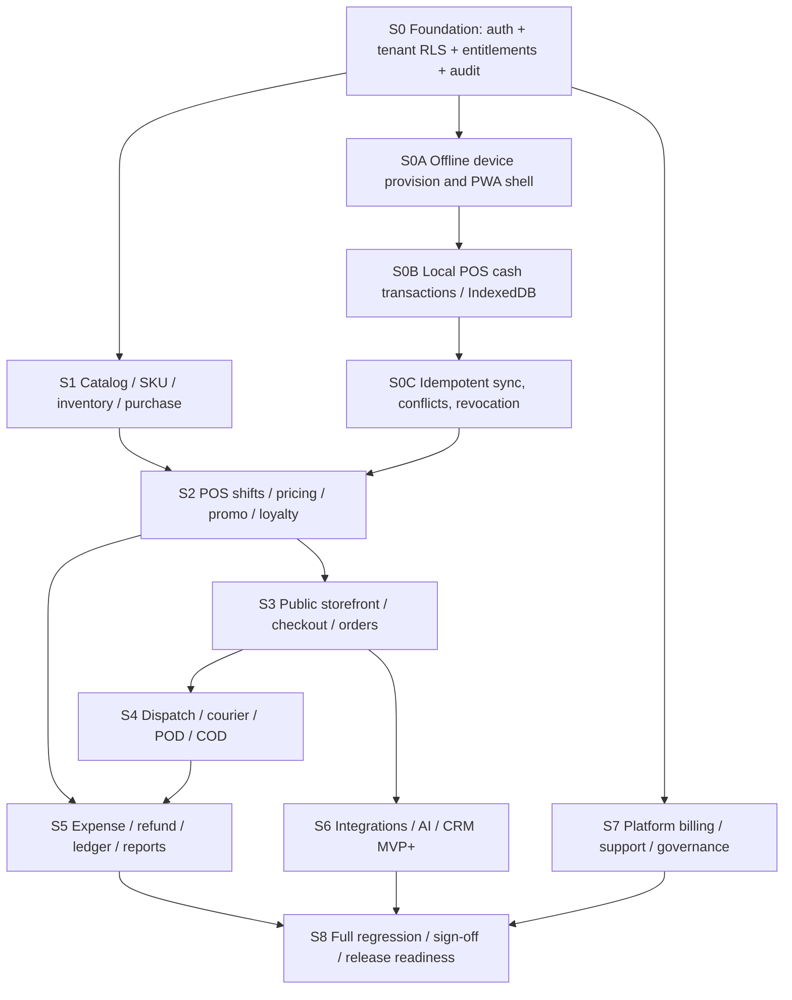

# PHASE 2.3 — UX Acceptance & Engineering Handoff
## Consolidated Draft for Review — Orbis Commerce

**Document version:** 1.0 (Phase 2.3)  
**Date:** 3 November 2026  
**Status:** **DRAFT FOR REVIEW — NOT SIGNED OFF**  
**Baseline PRD:** `MASTER_PRD_SaaS_POS_MultiTenant_Delivery_AI_v1.4.4.md`  
**Consolidated result:** `MASTER_PRD_SaaS_POS_MultiTenant_Delivery_AI_v1.4.5.md`  
**Prototype baseline:** `posverse_phase_2_2o_delivery_operations.html` (single HTML; demo logic)  
**Required reviewers:** Product Owner, UX Lead, Engineering Lead, Security/Privacy Lead, QA Lead, Finance/Operations representative.

> **Decision status:** This bundle is intended for review and controlled engineering planning. It is **not authorization to start coding** and **not production release acceptance**. Any API path or data entity marked proposed requires schema and ownership approval.

---

## 1. Executive handoff summary

Orbis Commerce is a multi-tenant POS SaaS with white-label branded storefront, tenant POS/cash management, per-SKU catalog/stock/purchase, expenses and reporting, membership/loyalty, promo engine, internal courier dispatch/COD, multi-provider integrations, AI Inbox/CRM and platform governance. **Offline POS remains MVP P0 from foundation**. The unofficial WhatsApp linked-device path is strictly optional/experimental with legal-security review; it is not a production-approved equivalent to the official API.

**What can be validated today:** the HTML prototype implements navigation, sample operational workflows and local browser state; Phase 2.2N and 2.2O provided role-specific interactive demonstrations; Phase 2.2O captured **90/90 targeted browser checks** (74 core + 16 negative). Phase 2.3 independently executed **532/532 route/role/viewport smoke checks** without runtime JavaScript errors or page-level horizontal overflow, across **133 role-route combinations × 4 viewport widths**. These numbers must not be described as full 12-role E2E or backend validation.

**What remains open:** complete normal/negative business journeys per role; installable offline PWA and IndexedDB transactions; API/RLS/security; financial ledger and payments; cross-module concurrency; secure POD and customer tracking; true GPS consent/device coverage; provider sandbox; end-to-end support grants, AI tool policies and billing. Their gates are tracked below.

### Artifact inventory

| Artifact | Purpose | Rows / scope |
|---|---|---|
| `PHASE_2_3_ENGINEERING_HANDOFF_DRAFT.md` | This decision and implementation review | Handoff guidance and sign-off |
| `PHASE_2_3_SCREEN_FR_API_DATA_PERMISSION_TRACEABILITY.csv` | Source-controlled screen/role → FR → API → data → permission → acceptance → slice | **137** mapped rows, 62 distinct screen/flow IDs |
| `PHASE_2_3_UX_ACCEPTANCE_CASES.csv` | Executable-when-ready acceptance case inventory | **109** cases (62 screen/workflow + 47 cross-module) |
| `PHASE_2_3_12_ROLE_E2E_JOURNEYS.csv` | Per-role positive and two negative journeys | **36** specified, not executed |
| `PHASE_2_3_BLOCKER_AND_DECISION_REGISTER.csv` | Open issues, severity, owner, evidence to close | **26** blockers / decision requests |
| `PHASE_2_3_ROUTE_REGRESSION_EVIDENCE.json` | Machine-readable smoke-test evidence | **532 passed / 532 executed** |
| `MASTER_PRD_SaaS_POS_MultiTenant_Delivery_AI_v1.4.5.md` | Consolidated PRD, canonical precedence and phase 2.3 addendum | Preserves v1.4.4 history |

## 2. Canonical decisions and conflict resolution

| Decision ID | Canonical decision | Previously ambiguous/conflicting wording | Review status |
|---|---|---|---|
| D-001 | **Offline POS = mandatory MVP P0**, before broad pilot; use installable PWA, Service Worker, IndexedDB, signed/provisioned device, idempotent server sync | Legacy Section 03 says offline POS P2 and Section 00 says offline transaction queue not MVP | **Proposed resolved** by v1.4.5; PO sign-off pending |
| D-002 | MVP offline tender: **cash only**, receipt clearly **PENDING_SYNC**; globally limited promos, points redemption and payment gateway require online authorization | Offline promo/loyalty policy not explicitly signed | PO/Finance pending |
| D-003 | Core retail/F&B merchant POS + storefront + delivery are P0; AI official WhatsApp + CRM is **MVP+ after core**, opt-in and subject to provider approval | Scattered P0/MVP+ labels in historical PRD | PO confirmation pending |
| D-004 | Unofficial WA linked device is **experimental opt-in pilot only**, never positioned as supported/compliant API; possible account restriction/ban | Provider catalog could be misunderstood as production-ready | Legal/Security pending |
| D-005 | Register cash and order payment are ledger-backed; close-shift record immutable; later refunds post authorized movements, not silently editing closed shift | Prototype has mixed local snapshots | Finance/Engineering pending |
| D-006 | One physical+reserved stock authority per `(tenant,outlet,variant SKU)`; customer order, POS, receiving and return use one server service | Historical legacy parent-stock assumptions | Engineering pending |
| D-007 | COD **COLLECTED**, **REMITTED**, **VERIFIED** and order **PAID** are distinct; returns do not auto-restock or auto-refund | Multiple older delivery entry points in prototype | Finance/Delivery pending |
| D-008 | Platform administrative plane requires MFA, least privilege, JIT support access, independent maker-checker and immutable audit; demo actor switch is not security | Local actor toggle may appear as real approval | Security pending |
| D-009 | Location tracking **foreground opt-in only** for courier PWA; no claimed background GPS/ETA | Simulated GPS sample | Privacy/Delivery pending |
| D-010 | Multi-channel integration provider list is **candidate catalog**, not assertion that live OAuth/API access is available | Provider catalog demo | Product/Integration pending |
| D-011 | Membership, promo, refund, tax/service and cashback must reference immutable checkout/line snapshots and round with an approved allocation policy | Refund proportional proration is incomplete for production | Finance pending |
| D-012 | Public storefront ratings, units sold, flash sale claims must use audited real metrics; prototypes can show explicitly marked sample data | Simulated reviews and sales counts | Product/Legal pending |

**Conflict priority order:** explicit current Product Owner decisions > Phase 2.3 canonical decisions signed by PO > Phase 2.2O domain contracts > Phase 2.2N domain contracts > Phase 2.2M financial contracts > Phase 2.2K POS > earlier addenda > original v1.0 prose. This rule only applies once v1.4.5 is approved; unresolved matters stay in this register. No silent overwrites.

## 3. UX acceptance evidence versus uncovered scope

| Layer | Evidence from current work | Result | Meaning |
|---|---|---|---|
| Navigation & responsive smoke | 12 roles; 133 role-route combinations; 4 widths = **532** | **Passed 532/532** | Only route rendering, empty layout checks, page overflow and JS errors |
| Dispatcher/Courier task workflows | Phase 2.2O 74 core + 16 negative checks | **Passed 90/90 as scoped** | Local state transitions and frontend checks, not provider/backend |
| Platform Super Admin | Phase 2.2N 11 screens + 21 interactive assertions | **Passed as scoped** | Local maker-checker simulation, not authenticated users |
| POS financial path | Earlier Phase 2.2M closure examples | **Targeted local tests reported passed** | Does not prove full ledger or gateway integration |
| Public storefront / guest auth full journey | Not part of 133 role-route checks | **Pending** | Needs checkout/track/account verification end to end |
| All 12 role business journeys | Not all core actions tested on all roles | **Pending** | Must run positive and negative scenarios |
| Mobile with CDN / devices / a11y | Playwright used `set_content` with external assets blocked | **Pending** | Requires actual browsers/devices/fonts/Tailwind, keyboard and screen-reader |
| Backend/API/database/payment/offline production | No connected production stack in the prototype | **Not implemented / Not validated** | Cannot sign off production |

### Role-screen coverage (from live prototype navigation)

| Role | Route yang dipetakan | Pemilik workflow | Kondisi acceptance |
|---|---:|---|---|
| `platform` | 12 | Tenant lifecycle, billing, entitlement, provider, fleet, audit | Route smoke pass; workflow end-to-end belum seluruhnya |
| `support` | 4 | Support metadata, ticket, grant (tanpa data tenant mentah) | Route smoke pass; workflow end-to-end belum seluruhnya |
| `owner` | 36 | Tenant operations dan konfigurasi lintas outlet | Route smoke pass; workflow end-to-end belum seluruhnya |
| `brand` | 15 | Storefront, brand catalog, marketing, KB | Route smoke pass; workflow end-to-end belum seluruhnya |
| `manager` | 23 | POS/stock, refund approval, delivery/outlet | Route smoke pass; workflow end-to-end belum seluruhnya |
| `cashier` | 5 | Kasir, shift, cart, member, penjualan | Route smoke pass; workflow end-to-end belum seluruhnya |
| `dispatcher` | 10 | Assignment, SLA, exception, COD, POD | Route smoke pass; workflow end-to-end belum seluruhnya |
| `courier` | 5 | Task milik sendiri, pickup, COD, proof | Route smoke pass; workflow end-to-end belum seluruhnya |
| `ai` | 7 | AI configuration, inbox, channel, credit | Route smoke pass; workflow end-to-end belum seluruhnya |
| `cs` | 5 | Handoff, CRM, follow-up, order scoped | Route smoke pass; workflow end-to-end belum seluruhnya |
| `finance` | 10 | Expense, POS/COD reconciliation, laporan | Route smoke pass; workflow end-to-end belum seluruhnya |
| `customer` | 1 | Customer portal overview; storefront publik di luar menu role | Route smoke pass; workflow end-to-end belum seluruhnya |

**Additional public flows:** Landing/auth/onboarding, public storefront, guest checkout, and secure customer tracking are mapped as four extra rows in the CSV, outside the 133 role menu combinations. Customer role's `overview` does not itself prove guest checkout integration.

## 4. UX/interaction contract per screen

For each of the **62 screen/flow IDs**, required review states are: initial loading; empty state; populated list/detail; filtering/sort/pagination; create/edit form valid; invalid fields with inline errors; 401/403 denied; 409 concurrency conflict; offline/connection loss; provider failure where relevant; retry without duplicate mutation; success/receipt; responsive 320/390/768/1440; keyboard focus, modal close and screen reader labels. Hide sensitive information from read-only roles; do not allow a hidden menu to stand in for authorization.

Each transition must document: trigger, actor, preconditions, tenant/outlet/brand/device scope, data written, idempotency key, version constraint, events emitted, side effects, reversal/compensation, audit shape, response/error and visible UI state. "Saved" messages occur only after server acknowledgement; for offline writes use **Pending Sync**.

### Canonical navigation ownership

- **Platform / Support:** platform administrative plane, not business data default.
- **Tenant Owner / Brand Admin / Outlet Manager:** tenant setup, merchandising, purchasing, storefront, sales, delivery and analytics within delegated scope.
- **Cashier:** register, opening cash, POS, membership redemption and scoped order/refund request. No privilege escalation from cart UI.
- **Dispatcher / Courier:** queue, assignment and task lifecycle; courier sees only current identity's jobs.
- **Finance:** expenses, closing, COD remittance decisions, payment/refund reconciliation, reporting.
- **AI Manager / CS:** persona, knowledge, channel, credits, conversations, handoff, CRM; AI service identity distinct from staff.
- **Customer/Guest:** public branded shopping, checkout and secure tracking only.

## 5. Screen → FR → API → Data → Permission → Acceptance → Development Slice

**Full matrix:** `PHASE_2_3_SCREEN_FR_API_DATA_PERMISSION_TRACEABILITY.csv`. Exactly **137** mapping rows (133 menu role-route + 4 public/auth) cover **62** distinct screen/flow IDs. All referenced FR IDs have been checked against the current v1.4.4 source. API paths are **contract proposals**, not deployed endpoints. Permission column states desired backend behavior; client navigation is not enforcement.

### Traceability excerpts

| Screen / role contoh | FR kanonik | API usulan (ringkas) | Data utama | Slice |
|---|---|---|---|---|
| `n22-tenant-detail` / platform | `FR-PLT-003,FR-PLT-005,FR-PLT-006` | `GET /v1/platform/tenants/{id}/summary` | `tenants` | S7 |
| `n22-fleet` / platform | `FR-PLT-023,FR-PLT-024,FR-PLT-025,FR-PLT-027` | `GET /v1/platform/devices` | `register_devices` | S0C |
| `pos` / owner | `FR-05,FR-POS-OPS-004,FR-TXI-001,FR-L22-001` | `GET /v1/catalog/items` | `products` | S2 |
| `pos-operations` / owner | `FR-POS-OPS-002,FR-POS-OPS-006,FR-POS-OPS-007` | `POST /v1/pos/shifts/open` | `pos_registers` | S2 |
| `membership` / owner | `FR-MEM-001,FR-MEM-003,FR-MEM-010` | `GET /v1/tenant/members` | `loyalty_members` | S2 |
| `tenant-operations` / owner | `FR-PUR-201,FR-TXI-007` | `POST /v1/tenant/purchase-orders` | `suppliers` | S1 |
| `storefront` / owner | `FR-02,FR-07,FR-SFB-001,FR-STP-007` | `GET /v1/brands` | `brand_themes` | S3 |
| `lifecycle-closure` / owner | `FR-E22-004,FR-E22-005,FR-M22-005` | `POST /v1/tenant/returns` | `returns` | S5 |
| `expenses` / owner | `FR-EXP-201,FR-TXI-009` | `GET/POST /v1/tenant/expenses` | `expenses` | S5 |
| `o22-queue` / owner | `FR-DLV-002,FR-DLV-003,FR-DLV-004,FR-DLV-006` | `GET /v1/tenants/{tenantId}/delivery/jobs` | `delivery_jobs` | S4 |
| `o22-courier-tasks` / courier | `FR-DLV-005,FR-DLV-008,FR-DLV-009,FR-DLV-016` | `POST /v1/tenants/{tenantId}/delivery/jobs/{id}/assignments/{offerId}/respond` | `courier_assignments` | S4 |
| `o22-cod` / owner | `FR-DLV-018,FR-DLV-020,FR-DLV-021` | `GET /v1/tenants/{tenantId}/delivery/cod/balances` | `cod_collections` | S5 |
| `inbox` / owner | `FR-15,FR-16,FR-INT-006` | `GET /v1/conversations` | `conversations` | S6 |
| `public-checkout` / customer | `FR-06,FR-08,FR-PROMO-009` | `POST /public/checkout` | `carts` | S3 |

**Traceability acceptance rule:** no development slice may be called feature complete while its mapped FR, schema migration, permission proof, negative test and UI states lack a verifiable test evidence link and reviewer. Required fields for issue tracker: `matrix_id, FR_id, route, roles, API_contract, data_entities, permission, positive_AT, negative_AT, slice, status, evidence_URI, reviewer, decision_date`.

## 6. Cross-module state and financial integrity contracts

| Boundary | Atomic invariant / expected behavior | Required failure test |
|---|---|---|
| Product/SKU → POS | Selected variant ID + current trusted price/HPP snapshot; available stock checked atomically | Unknown SKU, stale price, stock race, cross tenant |
| Offline POS → sync | Durable local sale+cash+stock journal and stable local transaction ID; server consumes idempotently | Crash before/after commit; replay batch; conflicting devices |
| PO → receipt → stock | Receipt references approved PO line; partial receive; stock movement once | Over-receipt, duplicate receipt, wrong outlet |
| POS → promo → points → tax → payment | Deterministic line allocation, explicit rounding, total captured equals due | Expired promo, over-redemption, partial payment |
| Order → return → refund | Return quantity bounded, classification before restock; refund reverses proper payment/loyalty allocation | Repeat refund, damaged restock, closed shift mutation |
| Shift → cash movements → closing | Expected cash = opening + cash sales + cash in − cash out − authorized cash refund | Double capture, negative cash, counted variance |
| Delivery assignment → POD | One current assignment version, checklist before pickup, COD exactness on delivery | Stale accept, fake courier, skipped checklist |
| COD → remittance → finance | Verified setoran drives PAID, not courier's collected statement | Double verify, partial/outstanding, intertenant |
| AI/Channel → Inbox | Inbound signed/deduped, canonical contact, human take-over prevents further AI reply | Prompt injection, race on takeover, credit cap |
| Platform → tenant entitlements | Control plane changes audited; business API rejects disabled module regardless of frontend menu | Direct API calls, stale entitlement and revoked device |

**Key implementation direction:** use `PostgreSQL` ACID transactions plus RLS for server state, immutable stock/cash/payment/points journals, *transactional outbox*, domain-specific state machine services and idempotency keys; Redis queues only for retries/event work. Cross-domain effects should use versioned events and compensating actions rather than fabricating distributed atomicity across payment providers.

## 7. Contract decision policy before coding

### API

- Proposed version prefix `/v1`, but use one consistent tenant context strategy. Platform `/v1/platform/*` is separate privilege boundary; business APIs must bind tenant server-side from authenticated membership. Explicit `/v1/tenants/{tenantId}` routes must verify that tenant ID against principal, not trust arbitrary URL input.
- Every mutation has typed request/response contract, auth, role/entitlement guards, `Idempotency-Key` where replay-prone, `If-Match` version/optimistic concurrency where stateful, server-generated timestamp and immutable audit correlation ID.
- Error taxonomy: `401 unauthenticated`, `403 forbidden`, `404 non-disclosing missing resource`, `409 conflict/stale version`, `422 validation`, `429 quota/rate`, `503 dependency unavailable`; retries and offline queue must not turn uncertainty into false success.
- Public APIs require scoped/expiring tokens, abuse protection and no private courier location or cross-tenant PII.
- Server-side schemas and migrations are pending. Shared API naming must be reconciled: `/v1/catalog/items` and `/v1/tenant/products`, `/v1/deliveries` and `/v1/tenants/{tenantId}/delivery` appear in historical proposals. The final OpenAPI should pick canonical paths with redirects/aliases only if required.

### Data and tenancy

Enforce RLS for all tenant-owned records. Unique indexes must cover `(tenant_id, outlet_id, SKU)` and one open shift per register, unique payment/refund/stock/loyalty event IDs, current courier assignment, device/register binding, provider webhook idempotency, and COD remittance signatures. Separate published storefront content from draft store-builder config. Every migration must include backfill/cutover and rollback approach for demo-old or production-legacy data.

### Offline-first POS (MVP P0; architectural blocker)

Installable PWA + Service Worker for shell/catalog caching; IndexedDB stores encrypted-at-rest where supported and protected with device authentication/short authorization TTL for local transaction queue, register session and price snapshot. Encryption in web storage is **not** equivalent to hardware-backed key security. Use sequential local transaction ID and protected sync outbox; reconnect with server auth, idempotent batch acceptance, reconciliation, conflict workflow and customer receipt `PENDING_SYNC`. QRIS/gateway/COD authorization and point redemption requiring global limits are **not deemed paid or confirmed offline**. Offline data must respect retention, secure wipe policy, device theft threat and operational recovery. Single-file HTML prototype **does not provide** this runtime; engineering must implement a multi-asset deployed PWA.

### Sensitive operations and privacy

Support grants require independent approver, MFA, purpose and expiry. WhatsApp official must follow provider terms and consent; unofficial connector remains pilot-only pending written approval. AI cannot autonomously refund/alter stock or execute direct SQL. GPS is foreground opt-in; POD media private/signed/retained per policy; customer tracking token expires. All uploads validate type and size server-side; exports restrict PII/CSV injection; logs redact credentials.

## 8. Acceptance scenarios — runnable inventory

**Complete list:** `PHASE_2_3_UX_ACCEPTANCE_CASES.csv`: **109** cases: 62 per-screen/workflow acceptance designs plus **47 cross-module / adversarial / operational** cases. **Only prior scoped checks are marked in evidence summary; this inventory is NOT executed in full.** Every case requires a positive path and at least one failure-state check. High-risk examples:

| Test | Priority | Expected closure |
|---|---|---|
| `P23-X01` | P0 | Cross-tenant ID, exports and background jobs deny at server/database |
| `P23-X04`–`P23-X08` | P0 | Offline provision, transaction persistence, sync idempotency, revoke and conflict reconciled |
| `P23-X11`–`P23-X15` | P0 | Split payment, cash refund, partial line allocation and points reversible |
| `P23-X25`–`P23-X31` | P0 | Delivery assignment concurrency, ownership, retry/POD/COD and outbox |
| `P23-X32`–`P23-X34` | P0 for AI module | Handoff race, tenant tool policy and hard credit cap |
| `P23-X38`–`P23-X41` | P0 | SaaS billing reconciliation, entitlement guard, maker-checker and verified backups |
| `P23-X43`–`P23-X47` | P0 | Accessibility, CDN/real-device, 12-role complete journeys, migration and fault states |

### Regression runner acceptance

Given a deterministic seed of two independent tenants with separate brands/outlets/users; when running all 12 role journeys under widths 320/390/768/1440; then all allowed transitions succeed, all forbidden transitions return explicit denial, evidence is retained, and no production capability is claimed from mock data. For API integration, execute the same cases against a real PostgreSQL tenant-RLS backend and provider sandboxes, not only `localStorage`.

### 12-role positive and negative journeys

An additional executable **36-case** journey plan (one positive and two negative cases for each of the 12 roles) is provided as `PHASE_2_3_12_ROLE_E2E_JOURNEYS.csv`. It is **DESIGNED_NOT_EXECUTED**; no role is granted full end-to-end sign-off on the basis of route smoke. Use this inventory to seed E2E automation under real authenticated identities, tenant/outlet fixtures, financial journals, provider sandbox and offline device harness.

## 9. Slice dependency graph and execution contract

| Slice | Primary ownership | Inputs required | Measurable exit gate |
|---|---|---|---|
| **S0** | Backend/Security | Decision register approved, tenancy model | MFA role proof, tenant RLS tests, invite, audit, module entitlement block |
| **S0A** | Frontend/PWA/Security | S0 identity and device policy | Installable PWA, register provision, TTL/revoke policy |
| **S0B** | POS/PWA | S0A, cash policy | Offline cash shift+checkout survives refresh/crash; pending receipt |
| **S0C** | Backend/Worker | S0B, stock rules | Exactly-once logical ingest, replay tests, conflict ledger |
| **S1** | Catalog/Inventory | S0, canonical SKU policy | Variant movement, receiving and stock invariants tested |
| **S2** | POS/Checkout | S1, S0C, pricing policy | Shift/cart/promos/loyalty/split payment golden tests |
| **S3** | Storefront/Orders | S2, brand/outlet profile | Store builder publish/guest checkout/token security |
| **S4** | Delivery | S3, scoped couriers | Assignment race, pickup, exceptions, POD, COD collection |
| **S5** | Finance/Analytics | S2, S4, refund policy | Reconciled journal, expenses, COD remittance, report golden set |
| **S6** | Integration/AI | S0, S3, provider approval | Official channel sandbox, consent, AI tool guard and budget |
| **S7** | Platform Ops | S0, tenant commercial policy | Provisioning, billing, quotas, support approval, backup drill |
| **S8** | QA/SRE/Product | All relevant MVP slices | Full 12-role E2E, mobile/a11y, load/privacy/incident/security evidence |

**Parallelization:** S1 and S0A may be worked in parallel after S0 contracts. S7 commercial components may progress in parallel after S0 as long as entitlement enforcement is integrated before paying tenants onboard. S6 AI/MVP+ can be piloted after core S3 and does not block basic cash POS, provided AI has no backdoor to transactions. External provider implementation depends on approvals and sandbox credentials. **No engineering changes to canonical foundations without ADR and owner review.**

### Slice work ticket template

`Ticket ID; slice; screen/route; FR(s); actor & scope; domain owner; input/output schema; tables & indexes; lifecycle guard; idempotency/version; audit/outbox; UI empty/loading/error; positive/negative tests; mobile check; migration plan; reviewer; evidence links; pass/fail`. Every ticket must link one or more `P23-TM-xxx` rows and relevant test IDs.

## 10. UX + mobile acceptance checklist

Every major screen: responsive at 320/390/768/1440px with no page overflow; long tables confined to scroll containers; contrast and touch targets meet agreed WCAG 2.2 AA test rubric; focus visible and modal trap/restore; form errors adjacent and announced; toggle states accessible; video/GPS permission voluntary; inline offline and pending-sync status; no fake success toast; appropriate timezone/locale; all currencies integer minor unit (IDR); safe navigation back across roles and tenant switching; manual printer/scanner behavior specified for POS devices; courier task actions feasible on mobile without accidental long forms. The "Passed" smoke result does **not** replace this checklist.

## 11. Security, reliability and operations gates

- **Auth and data:** session management, MFA high privilege, RLS/ABAC, tenant key segregation, object-level authorization, CSRF/CORS, signed links, secret management, logged access.
- **Financial:** immutable order line/payment/refund/stock/point journals, reconciliation, cash counts, COD remittance, duplicate prevention, refund authorization, provider settlement webhooks.
- **Offline:** encryptable local persistence per device, key/TTL strategy, pending sync banner, backpressure, batch retry, duplicate prevention, conflict inbox, device revoke ACK.
- **AI and channels:** official provider sandbox, explicit unofficial pilot risk, human handoff no-double-reply, approved tools, privacy consent and memory retention, quotas/cost circuits.
- **Ops:** audit log integrity, real metrics and alerts, SLO thresholds, tested backup/restore, RPO/RTO decision, incident runbooks, rollout/rollback, update/version compatibility of offline POS.

## 12. Blockers and final decisions for review

**Complete blocker register:** `PHASE_2_3_BLOCKER_AND_DECISION_REGISTER.csv` — **26** open issues or decisions. P0 release blockers may be planned as engineering tickets, but cannot be marked closed by design/prototype alone. Distinguish:

1. **Before UX sign-off:** B-001 (full role journeys), B-002 (mobile/a11y), B-017 (negative UI states), B-023 (public/auth journeys), B-025 (store-builder publish check).
2. **Before engineering contracts can be frozen:** B-003 (canonical Offline POS decision), B-018/B-019 (cash, promo/loyalty/refund/costing policy), B-022 (API/OpenAPI/data ownership).
3. **Before MVP release:** B-004–B-016, B-020 when unofficial pilot is enabled, B-021 when AI module is enabled, B-024/B-026 (legacy paths and privacy).

### Specific unresolved decisions requiring explicit answers

| Decision | Options requiring approval | Recommended draft default |
|---|---|---|
| Offline tender | Cash-only / additional local tender | **Cash-only** and pending-sync receipt |
| Offline access TTL | Duration and revocation grace | Choose risk-based bounded TTL; **value TBD** |
| Inventory cost policy | Weighted average / FIFO | Weighted average for MVP, **Finance sign-off pending** |
| Discount+tax order | Per-line before/after tax base, rounding | Line snapshots and deterministic algorithm; **rates/tax treatment TBD** |
| Partial return | Restock quarantine vs sellable after inspection | Quarantine until authorized check-in |
| Refund for closed shift | New payout event / reopen closed shift | **New authorized payout movement**, never modify closed snapshot |
| Support access | Metadata only / temporary scoped sensitive read | Metadata by default; just-in-time approved scoped read only |
| SLA delivery | Threshold per outlet/zone | Configurable thresholds; **numeric policy TBD** |
| Currency/timezone | Single IDR/WIB vs per-outlet timezones | IDR, per-outlet IANA timezone in Indonesia |
| WA unofficial | Disable/pilot/production | **Disable by default; pilot conditional, not production commitment** |
| AI MVP timing | MVP core vs MVP+ | MVP+ after POS/storefront/delivery isolation and tool security |

## 13. Review and sign-off workflow

| Reviewer | Required review | Decision state |
|---|---|---|
| Product Owner | MVP P0/P1 boundaries, feature flags, pricing/service restrictions | **PENDING** |
| UX Lead | Screen completeness, 12-role journeys, real mobile/a11y acceptance | **PENDING** |
| Engineering Lead | API/data ownership, migration order, dependency DAG, contract tests | **PENDING** |
| Security/Privacy | Tenant isolation, offline key policy, GPS/POD data handling, provider risk | **PENDING** |
| Finance/Operations | Cash/refund/COD ledger, tax/proration, closed-shift rules | **PENDING** |
| QA Lead | 109 test inventory execution coverage, critical negative cases, evidence trace | **PENDING** |
| SRE/Platform | Observability, backup/restore drills, outages and rollout policy | **PENDING** |

**Review outcome field** for each reviewer: `APPROVE`, `APPROVE_WITH_CONDITIONS` (named blockers and deadline), or `CHANGES_REQUESTED`. Record identity, date, approved artifacts/hash, outstanding blockers, and review comments. Do not mark "approved" without human authorization; current state is **DRAFT FOR REVIEW**.

## 14. What does acceptance mean now?

- **Phase 2.3 artifact completeness:** **DRAFT COMPLETE FOR REVIEW** — matrices and contract proposals are available and internally validated against actual routes/FR identifiers.
- **UX acceptance:** **NOT SIGNED OFF** — navigation smoke is strong, but public and full business journeys, error state and real mobile/a11y are pending.
- **Engineering contract sign-off:** **NOT SIGNED OFF** — OpenAPI, schema DDL, threat model decisions and owners not yet accepted.
- **Production readiness:** **NOT SIGNED OFF** — local HTML does not implement production backend, offline engine, payment gateways, privacy/security operations or real telemetry.

**Next authorized action after review:** resolve Product/Security/Finance decisions and UX gates, obtain formal review decisions, then convert traced items into scoped S0/S0A/S0B/S0C–S8 engineering tickets without changing approved foundation silently. This handoff itself does not initiate implementation.
